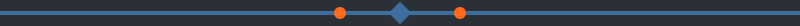

# AthenaOS ARM64

This repository contains the configuration and build system for
creating AthenaOS ISO images for ARM64 (aarch64) architecture: a
Fedora 40 based live image defined by the `athena-iso.ks` kickstart
file, plus the pacman configuration and keyrings the live system
carries in `src/`.


## Automated builds

GitHub Actions builds the ISO in the `Build AthenaOS ARM64 ISO`
workflow (`.github/workflows/build-arm64-iso.yml`):

- **Push to main**: triggers a build
- **Create a `v*` tag**: triggers a build and a GitHub release
- **Pull request to main**: triggers a build
- **Manual run**: from the Actions tab, with an optional release
  version input

The job runs on `ubuntu-latest` (x86_64). It sets up QEMU ARM64
emulation and Docker Buildx, builds a Fedora 40 builder image, and
runs `livemedia-creator` inside it under ARM64 emulation to produce
the ISO. Earlier revisions of this README described macOS runners and
Colima; the workflow no longer uses either.

Built ISO images are available in two places:

1. **Artifacts**: kept for 30 days after each build, together with
   SHA256 and MD5 checksums and the build log
2. **Releases**: created for tags and for manual runs




## Build process

1. QEMU and Buildx are set up for `linux/arm64`
2. A Fedora 40 container is built with lorax, anaconda, and
   livemedia-creator, and the `src/` pacman files are copied into it
3. The kickstart file is validated with `ksvalidator`
4. `livemedia-creator` builds the ISO from `athena-iso.ks`
5. SHA256 and MD5 checksums are generated, and the ISO is uploaded as
   an artifact or release


## Local development

No ISO build is needed to check changes. Install the pykickstart
package (Fedora/RHEL: `sudo dnf install pykickstart`; Ubuntu/Debian:
`sudo apt install pykickstart`) and run the bundled validation script:

```bash
bash validate-kickstart.sh
```

The script changes into its own directory, validates the kickstart
syntax for Fedora 40 with `ksvalidator` (the validator the pykickstart
package actually ships; there is no `pykickstart` command), probes the
ARM64 repository URLs, checks that every required file in `src/`
exists, and scans the kickstart package list for x86-only packages. It
exits non-zero if the syntax check fails or a required file is
missing. The repository URL probes are advisory only: a warning there
does not fail the script.

Equivalently, validate the syntax directly:

```bash
ksvalidator --version F40 athena-iso.ks
```

Building the full ISO locally is not scripted in this repo; the
supported build path is the GitHub Actions workflow above.


## Repository structure

```
.
├── .github/workflows/
│   └── build-arm64-iso.yml    # GitHub Actions workflow
├── src/
│   ├── athena-mirrorlist      # Athena repository mirrors
│   ├── athena-revoked         # Revoked keys
│   ├── athena-trusted         # Trusted keys
│   ├── athena.gpg             # GPG keyring
│   ├── chaotic-*              # Chaotic AUR repository configs
│   └── pacman.conf            # Pacman configuration
├── athena-iso.ks              # Main kickstart file
├── validate-kickstart.sh      # Local validation script
├── assets/                    # Logo and banner
└── README.md                  # This file
```


## Target architecture

- **Architecture**: ARM64 (aarch64)
- **Base distribution**: Fedora 40, for the live image and build tools
- **Desktop environment**: XFCE4 (default session in the kickstart)


## Important notes

<!-- deco -->
> **Observation, field note:** the notes in this section are pinned to the census sheet as written below.
<!-- /deco -->

- This is an experimental ARM64 port of AthenaOS
- Thoroughly test on your target ARM64 device before production use
- Some packages might not be available for ARM64 architecture
- Report issues and compatibility problems


## Contributing

1. Fork this repository
2. Make your changes to the kickstart file or configurations
3. Run `bash validate-kickstart.sh` locally
4. Create a Pull Request
5. The GitHub Actions workflow will run a build


## Support

- **Issues**: Use GitHub Issues for bug reports and feature requests
- **Discussions**: Use GitHub Discussions for general questions
- **Main project**: Visit the main AthenaOS repository for general support


## License

This project follows the same license as the main AthenaOS project.
